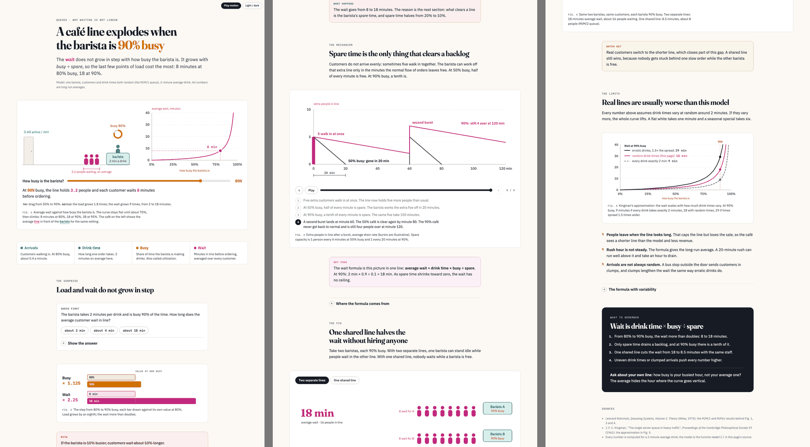

# claude-eli15-plugin

A Claude Code plugin that explains any topic as one self-contained HTML page whose figures carry
the explanation. The page has:

- a live model to drag,
- step-through diagrams with tokens riding the paths,
- before/after toggles,
- one predict-then-reveal question,
- one colour per concept, used the same way in the prose and in every figure.

The real numbers, the failure mode, the tradeoff and the open questions stay in. The pages are
written for a manager or a colleague from another team, who should be able to argue about the
topic after reading.

The output is a single `.html` file. It has no build step and runs no third-party JavaScript. It
works on a phone, in dark mode, with reduced motion, without JavaScript and in print.



Status: pre-release (`0.1.0-alpha.1`). See the [CHANGELOG](plugins/eli15/CHANGELOG.md) and [releases](docs/releases.md).

## Install

You need Claude Code, `uv` (`brew install uv`), Google Chrome or Chromium (for the ship check;
set `CHROME=/path/to/chrome` if it lives elsewhere) and `python3` (for the hook).

The repository is private. First let git use your GitHub login:

```sh
gh auth setup-git
claude plugin marketplace add DresvyanskiyDenis/claude-eli15-plugin --scope user
claude plugin install eli15@claude-eli15-plugin --scope user
```

Without an SSH key for github.com, export `CLAUDE_CODE_PLUGIN_PREFER_HTTPS=1` before the
`marketplace add`. Inside a session, the same two steps are
`/plugin marketplace add DresvyanskiyDenis/claude-eli15-plugin` and
`/plugin install eli15@claude-eli15-plugin`. Then run `/reload-plugins` or restart.

If you still have a standalone `eli15` skill in `~/.claude/skills/`, remove it. Both would load,
and the bare `/eli15` would keep running the old copy.

## Use

```text
/eli15:eli15 why our deploys take 40 minutes
/eli15:eli15 docs/proposal.md
```

The bare `/eli15` works too while no other command has that name. You can also just ask, for example "explain consistent hashing like I'm five" or "make an
explainer page of this proposal for my manager". The skill writes the page next to its source,
runs the check, looks at the screenshots, and opens the page.

## What is inside

| Path | What it is |
|---|---|
| `plugins/eli15/skills/eli15/SKILL.md` | The procedure: substance, concept shape, plan, copy the template, draw, check, look, report. |
| `…/assets/template.html` | The kit by example: a finished page (a café queue) with every component, the kit CSS and the runtime. Pages are copies of it. |
| `…/references/explainer-craft.md` | What to say: concept shapes, the explanation ladder, techniques that teach, analogy discipline, sentence rules. |
| `…/references/visual-system.md` | How it looks: concept colours, layout, components, the figure router, the never-list. |
| `…/references/motion-and-interaction.md` | How it moves: live model, stepper, toggle, predict, linked terms, ambient motion, URL parameters, reduced motion, print. |
| `…/scripts/check.py` | The ship check: static rules, a headless-Chrome audit at 1280 and 390 px through every step and state, and screenshot tiles. |
| `plugins/eli15/hooks/` | The ship gate (below). |

## The ship gate

The hook in `hooks/scripts/gate.py` makes sure no page leaves a turn unchecked:

- **After every Write or Edit**, it notes each `.html` file that carries the eli15 runtime.
- **When Claude or a subagent is about to finish**, it runs `check.py` on the pages that agent
  touched.
- **On a FAIL**, it blocks the stop and hands Claude the failures and the screenshot folder.
  After three failed fixes of one page it lets the stop through and tells you.
- **If `uv` is missing or the check cannot run**, it says so to you rather than looping.

It does not see pages written only through shell commands. The skill still tells Claude to run the
check itself; the gate is the net.

## Update

```sh
claude plugin marketplace update claude-eli15-plugin
claude plugin update eli15@claude-eli15-plugin
```

Then `/reload-plugins`. Updates arrive only when the version in `plugin.json` changes.

## Develop

```sh
uv run --with pytest pytest -q plugins/eli15/hooks/scripts
uv run plugins/eli15/skills/eli15/scripts/check.py plugins/eli15/skills/eli15/assets/template.html --allow-demo
claude plugin validate .
```

To try a change without installing it, run `claude --plugin-dir plugins/eli15`.

## Review changes

Every release has an explain-diff page under `docs/explanations/`, listed in
[docs/releases.md](docs/releases.md). To open one rendered:
`git show origin/main:docs/explanations/<file>.html > "$TMPDIR/<file>.html" && open "$TMPDIR/<file>.html"`.

## License

MIT, see [LICENSE](LICENSE).
